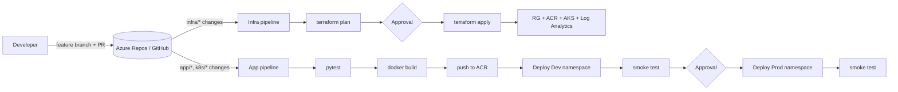

# End-to-End CI/CD on Azure Kubernetes Service (AKS)

Infrastructure provisioned with **Terraform**, application built and deployed with **Azure DevOps multi-stage YAML pipelines**, running on **AKS** with images stored in **Azure Container Registry (ACR)**.



## What this demonstrates

| Skill | Where |
|---|---|
| Multi-stage YAML pipelines, templates, environments | `pipelines/azure-pipelines.yml`, `pipelines/templates/` |
| Infrastructure as Code with remote state | `infra/terraform/`, `scripts/bootstrap-tfstate.sh` |
| Plan → approve → apply the *reviewed* plan | `pipelines/infra-pipeline.yml` |
| Containerization (multi-stage, non-root image) | `app/Dockerfile` |
| Zero-downtime rolling deploys, probes, autoscaling | `k8s/` |
| Automatic rollback on failed rollout | `pipelines/templates/deploy-aks.yml` |
| Passwordless ACR pull (managed identity + AcrPull) | `infra/terraform/main.tf` |
| Release gates & approvals | Azure DevOps Environments `dev`, `prod`, `infra-prod` |
| Branching strategy: PRs run CI only, `main` deploys | `trigger` / `pr` / `condition` blocks |

## Repository layout

```
app/                    Flask API, unit tests, Dockerfile
k8s/                    Deployment, Service (LoadBalancer), HPA
infra/terraform/        RG, ACR, AKS, Log Analytics, AcrPull role assignment
pipelines/
  azure-pipelines.yml   App CI/CD
  infra-pipeline.yml    Terraform plan/apply
  templates/            Reusable deploy + Terraform install templates
  scripts/arm-env.sh    Maps service connection creds to Terraform ARM_* vars
scripts/bootstrap-tfstate.sh   One-time remote state storage setup
```

## Prerequisites

- An Azure subscription (free trial works)
- An Azure DevOps organization and project (free tier: https://dev.azure.com)
- Azure CLI installed locally (`az login`)

## Setup — step by step

### 1. Push the code
Create a repo in Azure Repos (or GitHub) and push this folder to the `main` branch.

### 2. Create the Terraform state storage (one time)
```bash
az login
chmod +x scripts/bootstrap-tfstate.sh
./scripts/bootstrap-tfstate.sh centralindia
```
Note the three values it prints.

### 3. Create the Azure Resource Manager service connection
Project Settings → Service connections → New → **Azure Resource Manager** → **Workload identity federation (automatic)** → scope: Subscription.
Name it **`sc-azure-arm`**. Grant it access to all pipelines.

### 4. Create variable group `tfstate`
Pipelines → Library → + Variable group → name **`tfstate`**, add:
`TF_STATE_RG`, `TF_STATE_SA`, `TF_STATE_CONTAINER` (values from step 2).

### 5. Create environments with approvals
Pipelines → Environments → create **`infra-prod`**, **`dev`**, **`prod`**.
On `infra-prod` and `prod`: ⋮ → Approvals and checks → **Approvals** → add yourself.

### 6. Run the infrastructure pipeline
Pipelines → New pipeline → your repo → *Existing YAML* → `/pipelines/infra-pipeline.yml` → Run.
Review the plan output, approve the Apply stage. Takes ~8–10 minutes. Copy the outputs `acr_login_server`, `resource_group_name`, `aks_cluster_name` from the log.

### 7. Create the ACR service connection
Service connections → New → **Docker Registry** → **Azure Container Registry** → pick the new ACR.
Name it **`sc-acr`**.

### 8. Create variable group `aks-app`
`ACR_LOGIN_SERVER`, `AKS_RG`, `AKS_CLUSTER` (from step 6 outputs).

### 9. Run the app pipeline
New pipeline → `/pipelines/azure-pipelines.yml` → Run.
Watch it test, build, push, deploy to Dev, smoke test, then wait for your approval to deploy Prod. The smoke-test step prints the app URL.

### 10. Prove the workflow (screenshots for your portfolio)
1. Create `feature/update-message`, change the message in `app/app.py`, open a PR → only CI runs, nothing deploys.
2. Merge → the new version rolls out to Dev, then Prod after approval.
3. Break the health check on purpose (e.g. return 500) → rollout fails, pipeline rolls back automatically.

## Cost & cleanup

One `Standard_B2s` node + Basic ACR is roughly **₹4,000–5,000/month (~US$50–60)** if left running — check the Azure pricing calculator for current rates. Destroy it when you are done practicing:

```bash
az group delete -n rg-helloaks --yes --no-wait
az group delete -n rg-tfstate  --yes --no-wait   # only when finished with the project completely
```

## Design decisions (good interview talking points)

- **One cluster, two namespaces** for dev/prod keeps lab cost low. In a real company each environment would get its own cluster and subscription.
- **Apply the saved plan**, not a fresh plan, so what gets approved is exactly what gets deployed.
- **Workload identity federation** for the service connection: no client secret to store or rotate.
- **Managed identity + AcrPull** instead of ACR admin passwords or image pull secrets.
- **Image tagged with Build ID**, so every running pod traces back to a specific pipeline run and commit.
- **`maxUnavailable: 0`** plus readiness probes gives zero-downtime rolling updates.
- **Rollback on failed rollout** in the pipeline, so a bad release doesn't stay live.
